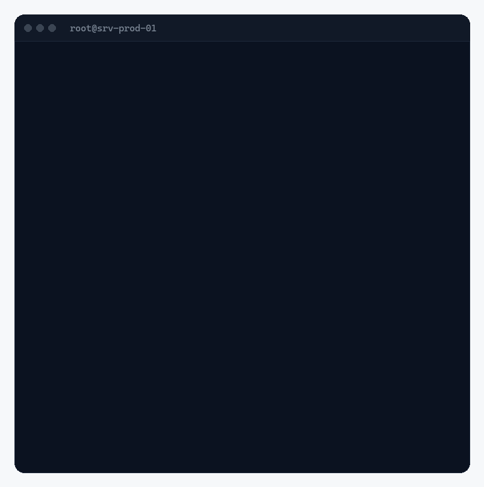

# stonewave

The Stonewave server CLI. It connects a company's Linux servers to [Wave](https://stonewavetech.com) (module
"Systems"), so the company's dev agent gets **safe, scoped hands** on them: short-lived SSH certificates, only the
rights an admin gave, every action logged with the person it was done for.

> **Early build.** `stonewave doctor` is real and read only. `connect`, `status` and `revoke` only show how the
> finished CLI will look: they change nothing on the machine. Nothing is released yet.



## How it will work

1. Wave shows an install command. Its checksum pins `install.sh`, and `install.sh` pins the binary.
2. `sudo stonewave` on the server shows a sign-in code. The admin enters it in Wave.
3. The admin's device makes its own key. **Each admin device is its own SSH certificate authority.** Only the public
   half goes to the server, and both sides show the same four words to compare.
4. A deterministic setup creates an agent user without sudo, a localhost-only SSH for that user (certificates only, a
   forced command), a small daemon that only connects **outbound**, an audit log and a health check. Every step checks
   first and keeps what is already in place. The server's own SSH stays untouched.
5. The agent gets certificates valid for at most one hour, signed by an admin device. Stonewave relays the
   connection but **cannot create access itself**. Right after connecting the agent may only read (logs, health).
   Critical actions (sudo, delete, firewall) always need a click in Wave, which signs a one-time certificate for
   exactly that command.
6. `sudo stonewave revoke` removes all agent access locally, also without internet. The audit log stays.

## doctor

```bash
stonewave doctor          # checks, shown on screen
stonewave doctor --json   # one JSON object, for agents and scripts
```

Read only: it reads `/etc/os-release`, `/proc/self/status` and `/etc/ufw/ufw.conf`, runs `uname -m`, `sshd -V`,
`timedatectl show` and `df`, and opens one TCP connection to `account.stonewavetech.com:443` without sending
anything. Exit code 0 means no check failed.

| Check | Fails when |
|---|---|
| System | no `/etc/os-release` (warns on systems not tested yet) |
| CPU | not x86_64 or aarch64 |
| systemd | not running |
| OpenSSH | the server's sshd is older than 8.2 (warns when sshd is missing) |
| Outbound | port 443 to the account service not reachable (only warns when an HTTPS proxy is set) |
| Root, Clock, Disk, Firewall, Stonewave | only warn or inform |

## Install (not released yet)

When a release exists, Wave shows a command like this one, with the real checksum:

```bash
curl -fsSLO https://stonewavetech.com/install/0.1.0/install.sh \
  && echo "<sha256 of install.sh>  install.sh" | sha256sum -c - \
  && sudo sh install.sh
```

[`install/install.sh.in`](install/install.sh.in) is short so it can be read first. It picks the binary for the CPU,
downloads it over HTTPS only, checks its SHA-256 against the value written into the script, installs it as
`/usr/local/bin/stonewave` and runs `stonewave doctor`. `sh install.sh --dry-run` checks everything and installs
nothing.

## Build and release

```bash
cargo build --release                           # this machine
scripts/release.sh 0.1.0                        # static Linux binaries (x86_64, aarch64) into dist/0.1.0/
scripts/test-install.sh dist/0.1.0              # on a Linux machine: doctor + install.sh --dry-run checks
```

`release.sh` builds static musl binaries with Rust's own linker (no cross toolchain needed, see
`.cargo/config.toml`), writes `SHA256SUMS`, writes the checksums into `install.sh` and prints the command for Wave.
With `STONEWAVE_MINISIGN_KEY` set to a minisign secret key it also signs the files. The key is never part of this
repository; without it the release is unsigned.

## Demo screens

```bash
stonewave connect    # sign-in, key check, setup progress (demo)
stonewave status     # how every later start looks (demo values)
stonewave revoke     # the local kill switch (demo)
stonewave banner
```

Keys: `y`/`n` answer, Enter skips the sign-in wait, `q` or Ctrl-C stops. The terminal is always restored. Keys typed
before a question appears are dropped, so a `y` typed ahead never confirms the key check.

| Situation | Result |
|---|---|
| Terminal with true colour (`COLORTERM=truecolor`, Windows Terminal) | 24-bit colour, animations |
| Other terminals | 256 colours, animations |
| `NO_COLOR` set | no colour, no animation |
| `--no-anim`, `STONEWAVE_NO_ANIM=1` | colour, final states only |
| Output not a terminal, `TERM=dumb`, fewer than 16 rows | plain lines, no escapes |
| No terminal to read keys from | every question is answered **no**; `--autoplay` plays the demo through |
| Narrower than 57 columns | one-line header instead of the banner |

The GIF and screenshots in `media/` are made from the program's own recordings (`--record`, asciicast v2), replayed
by `scripts/cast2gif.py` with Pillow.

## Layout

| Path | What |
|---|---|
| `src/main.rs` | arguments, commands |
| `src/doctor.rs` | the read-only checks |
| `src/term.rs` | terminal abilities, buffered output, raw mode, keys, recording |
| `src/style.rs`, `src/ui.rs`, `src/banner.rs` | colours, building blocks, banner and wave animation |
| `src/flow.rs` | the demo screens |
| `install/install.sh.in` | install script template |
| `scripts/` | release, install test, media renderer |

## License

Apache-2.0, see [LICENSE](LICENSE). Security issues: please use GitHub's private vulnerability reporting
("Report a vulnerability" under Security), see [SECURITY.md](SECURITY.md).
