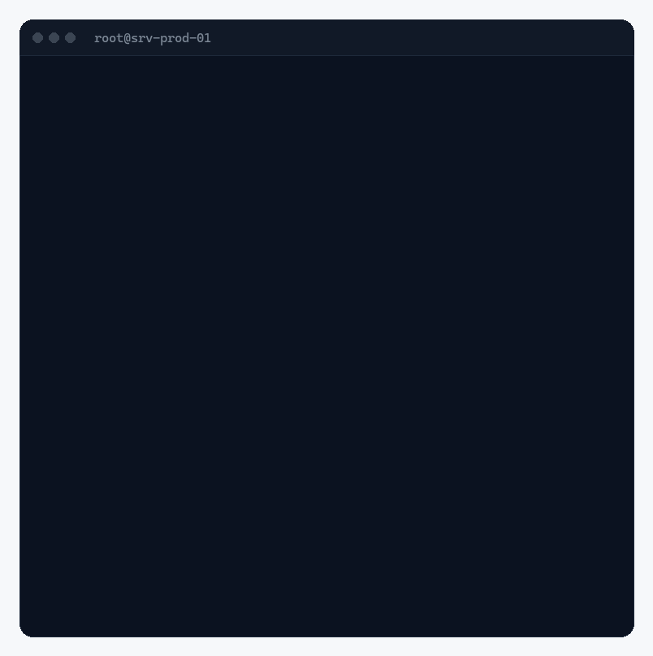

# stonewave

The Stonewave server CLI. It connects a company's Linux servers to [Wave](https://stonewavetech.com) (module
"Systems"), so the company's dev agent gets **safe, scoped hands** on them: short-lived SSH certificates, only the
rights an admin gave, every action logged with the person it was done for.

> **Early build.** `stonewave doctor` is read only. `stonewave connect` signs in with a device code, registers the
> server with Wave and sets it up (needs sudo; `connect --sign-in-only` only signs in). `setup`, `revoke` and the daemon
> are real. The Wave side is not switched on for customers yet: the relay is for Stonewave's own servers first.
> `connect --demo` and `status --demo` only show how the finished CLI will look.
> `stonewave agent ...` connects a coding agent on this machine to Wave; see [agent](#agent-connect-a-coding-agent-to-wave).



## How it will work

1. Wave shows an install command. Its checksum pins `install.sh`, and `install.sh` pins the binary.
2. `sudo stonewave connect` on the server shows a sign-in code. The admin enters it in Wave. (`stonewave` alone on a terminal opens the
   [menu of coding agents](#menu-and-station); as root it only points back to this command.)
3. The admin's device makes its own key. **Each admin device is its own SSH certificate authority.** Only the public
   half goes to the server, and both sides show the same four words to compare.
4. A deterministic setup creates an agent user without sudo, a localhost-only SSH for that user (certificates only, a
   forced command), a small daemon that only connects **outbound**, an audit log and a health check. Every step checks
   first and keeps what is already in place. The server's own SSH stays untouched.
5. The agent gets certificates valid for at most one hour, signed by an admin device. Stonewave relays the
   connection but **cannot create access itself**. Right after connecting the agent may only read (logs, health).
   Critical actions (sudo, delete, firewall) always need a click in Wave, which signs a one-time certificate for
   exactly that command.
6. `sudo stonewave revoke` removes all agent access locally, also without internet. The audit log stays.

## doctor

```bash
stonewave doctor          # checks, shown on screen
stonewave doctor --json   # one JSON object, for agents and scripts
```

Read only: it reads `/etc/os-release`, `/proc/self/status` and `/etc/ufw/ufw.conf`, runs `uname -m`, `sshd -V`,
`timedatectl show` and `df`, and opens one TCP connection to `account.stonewavetech.com:443` without sending
anything. Exit code 0 means no check failed.

| Check | Fails when |
|---|---|
| System | no `/etc/os-release` (warns on systems not tested yet) |
| CPU | not x86_64 or aarch64 |
| systemd | not running |
| OpenSSH | the server's sshd is older than 8.2 (warns when sshd is missing) |
| Outbound | port 443 to the account service not reachable (only warns when an HTTPS proxy is set) |
| Root, Clock, Disk, Firewall, Stonewave | only warn or inform |

### doctor --health

```bash
stonewave doctor --health          # how healthy is this server, plain text
stonewave doctor --health --json   # one JSON object, schema stonewave.health/1, for agents and scripts
sudo stonewave doctor --health     # as root, SMART and the process names of the ports are readable too
```

A second group of checks, next to the connect checks above. **Deterministic, read only, no model.** It is the
input of the nightly server check (the Hausmeister) and of the server alarm. Nothing is changed and no
command runs through a shell.

| Check id | Reads | Finding (severity) |
|---|---|---|
| `system` | `/proc/uptime`, `/proc/sys/kernel/osrelease` | facts only |
| `units` | `systemctl list-units --state=failed` | a failed unit (medium) |
| `reboot` | `/var/run/reboot-required` | reboot pending (medium) |
| `updates` | `apt list --upgradable`, age of the package lists | security updates (high), lists older than 7 days (low) |
| `autoupdates` | `20auto-upgrades`, `unattended-upgrade` | not active (medium) |
| `storage` | `df`, `df -i`, `findmnt` | 85 % high, 95 % critical (50 GiB and more: also by free space); inodes the same; `ro` mount of `/` or `/var` critical, other high |
| `raid` | `/proc/mdstat` | `[_U]` or `(F)`: always critical |
| `smart` | `smartctl` (root) | `FAILED`: critical; **not root: "not checked"** |
| `ports` | `ss -lntupH` | sensitive port (database, SMB, Docker API, ...) on a public address: high; the open ports: info |

**Schema `stonewave.health/1`** (a change that breaks readers gets a new number):

```json
{
  "schema": "stonewave.health/1", "stonewave": "0.2.0", "host": "srv-1", "ts": 1800000000, "root": false,
  "summary": { "highest": "high", "counts": { "critical": 0, "high": 1, "medium": 0, "low": 0, "info": 1 },
               "checks": 9, "not_fully_collected": 2 },
  "checks": [ {
    "id": "updates", "title": "Pending updates",
    "collection": "collected",            // collected | partial | not_collected
    "data": { "total": 3, "security": 2 },
    "findings": [ {
      "key": "updates:security",                      // the same thing keeps the same key in the next run: what a diff compares
      "severity": "high", "severity_de": "hoch",   // critical/kritisch, high/hoch, medium/mittel, low/niedrig, info
      "title": "2 security updates available", "location": "host · apt",
      "description": "...", "recommendation": "...", "trust": "measured",   // measured | derived
      "source": { "command": "apt list --upgradable", "lines": "2-3" },   // or { "file": "/proc/mdstat", "lines": "2-3" }
      "evidence": [ "openssl/jammy-updates,jammy-security 3.0.2 amd64 [upgradable from: 3.0.1]" ]
    } ],
    "not_collected": [ { "what": "...", "reason": "...", "needs": "run as root" } ]
  } ]
}
```

- **Source duty:** every finding names the command or file it comes from, the line numbers of that output and
  the lines themselves (at most five, control characters replaced, 200 characters each). Text from the
  machine is data, never an instruction.
- **Keys:** every finding has a `key` that stays the same for the same thing in the next run (`storage:disk:/data`, `units:nginx.service`,
  `raid:degraded:md0`, `updates:security`) and is unique within a run. A diff of two nightly runs compares keys, not titles (titles carry counts).
- **Not read is never "fine":** what could not be read stands under `not_collected` with the reason and what is
  needed, and the check is `partial` or `not_collected`.
- **Exit code:** 1 when something `high` or `critical` was found, else 0 (also when something could not be read;
  that is in the report). A refused call is 2.
- **Not used on purpose:** `pm2 jlist` and every command whose output can hold process environments or secrets
  (a test keeps the list of commands this group may run).

## Install

For you, on your own computer (no root, no administrator rights; installs into your user folder, tells you about PATH, updates in place):

```bash
curl --proto '=https' --tlsv1.2 -fsSL https://stonewavetech.com/cli/install.sh | sh          # Linux, macOS
```
```powershell
irm https://stonewavetech.com/cli/install.ps1 | iex                # Windows (PowerShell)
```

The installers check the download against a manifest (SHA-256, size), the Windows build against the Authenticode signature of Stonewave Tech
LLC and the macOS build against our Developer ID, and they run the program once before they put it in place. On Linux the checksum comes from
the same HTTPS site as the program: that protects against a damaged or swapped download, not against someone who controls the site. Options,
what is checked per system and how to uninstall: [docs/install.md](docs/install.md). How a release is made: [docs/release.md](docs/release.md).

### On a server (as root, pinned checksum)

When a server release exists, Wave shows a command like this one, with the real checksum:

```bash
curl -fsSLO https://stonewavetech.com/install/0.1.0/install.sh \
  && echo "<sha256 of install.sh>  install.sh" | sha256sum -c - \
  && sudo sh install.sh
```

[`install/install.sh.in`](install/install.sh.in) is short so it can be read first. It picks the binary for the CPU,
downloads it over HTTPS only, checks its SHA-256 against the value written into the script, installs it as
`/usr/local/bin/stonewave` and runs `stonewave doctor`. `sh install.sh --dry-run` checks everything and installs
nothing.

## Build and release

```bash
cargo build --release                           # this machine
scripts/release.sh 0.1.0                        # static Linux binaries (x86_64, aarch64) into dist/0.1.0/
scripts/test-install.sh dist/0.1.0              # on a Linux machine: doctor + install.sh --dry-run checks
```

`release.sh` builds static musl binaries with Rust's own linker (no cross toolchain needed, see
`.cargo/config.toml`), writes `SHA256SUMS`, writes the checksums into `install.sh` and prints the command for Wave.
With `STONEWAVE_MINISIGN_KEY` set to a minisign secret key it also signs the files. The key is never part of this
repository; without it the release is unsigned.

`release.sh` is for the server installer above. The release of the user installers (all systems, manifest, `/cli/` folder) is
`scripts/release-bundle.sh`: [docs/release.md](docs/release.md). `stonewave --version` prints `stonewave <version> (<commit>)`.

## Connect: sign in with a device code

```bash
sudo stonewave connect                   # sign in, register this server with Wave, set it up
sudo stonewave connect --account https://...  # another account address (or STONEWAVE_ACCOUNT_URL); https only, http only for this machine
```

`connect` asks the account for a code (RFC 8628) and shows it with four words. The admin opens the printed address,
signed in to their Stonewave account, types the code, checks that the page shows the same four words and that the
server name and address are right, picks the company and confirms. The CLI then receives a short token (15 minutes,
bound to that person and company), asks the account who it belongs to, shows the company and **drops the token**: it is
never written to disk and never printed.

With `sudo stonewave connect` that sign-in is the first step of the whole connect:

1. make the server's own Ed25519 key (it stays on the server, `/var/lib/stonewave/server.key`),
2. register its public half with Wave at the relay (`--relay <url>` or `STONEWAVE_RELAY_URL`; https only, http only for this
   machine), proving with a signature that the key is ours and for this sign-in only,
3. run the base setup (below), which starts the daemon,
4. the daemon holds one **outbound** HTTPS line to Wave, reports health once a minute and hands byte streams to the agent SSH
   on `127.0.0.1:2222`. A new server starts with no rights for the agent. See [docs/relay-protocol.md](docs/relay-protocol.md).

Nothing on the machine changes before Wave has accepted the key. `--trust-file <file>` trusts admin device keys right away
(until Wave hands them over); `--yes` skips the question. `stonewave status` shows the line, the agent SSH and the last
health report; `sudo stonewave revoke` closes it for good (and Wave can cut the line from its side: the daemon then
stops and is not restarted).

For agents and scripts, `sudo stonewave status --json` prints the same facts as one JSON object (no colour, no secrets;
`connected`, `daemon`, `agent_ssh`, `health`, ...). The exit code is 0 whenever the report could be made, whatever the state
is; it is non-zero only when the command itself failed. Without sudo it says `"readable": false` instead of guessing. `access_revoked` is the local
`sudo stonewave revoke`; when Wave cut the line, `line.state` is `"revoked"` and `connected` is false.

HTTP goes through the system `curl` (the install command needs it anyway), so TLS and the certificate store are the
system's. Secrets are handed to curl on stdin, never as arguments. A plain `http://` address is only accepted for this
machine (`127.0.0.1`, `localhost`, `::1`), for tests.

## Menu and station

```bash
stonewave                      # on a terminal: the full-screen menu (also `stonewave agents`)
stonewave --plain              # the same list as plain text, one screen, nothing is asked (scripts, agents)
stonewave agent station run --agent <name> --dry-run   # what a wake would run; starts nothing
stonewave agent station run --agent <name>             # wake the agent when a person of the company mentions it
```

The **menu** is a full-screen terminal program (banner with the wave, arrow keys, Enter, Esc, `q`): it lists the agents on this computer and walks
through connecting one and setting up its station in a few steps, each saying what it will do before it does it. It only starts the commands below
(and writes one user service file, shown first), so every check they make stays where it is. The text is German. Without a terminal, with
`--plain`, with `TERM=dumb` or on a terminal smaller than 50x16, the plain menu is used, in which a script cannot trip over a question.
How it works, step by step: [docs/menu.md](docs/menu.md).

The **station** keeps one long session per room for the agent and continues it on every wake, instead of starting a fresh run for each mention. A wake
has no shell and no web, one MCP server (Wave), its own working folder and limits for time, turns, cost and count. Slice 1 supports Claude Code.
Everything about it, including what was and was not tested: [docs/station.md](docs/station.md).

## agent: connect a coding agent to Wave

```bash
stonewave agent connect --engine grok     # claude-code | codex | grok | other
stonewave agent status [--json]
stonewave agent rotate
stonewave agent disconnect [--yes] [--keep-remote]
stonewave agent run [--agent <name>] -- claude     # start the agent with its key in the environment
```

This turns a coding agent on **any** machine (your Mac, a Linux server, a Windows PC) into an external agent of a Wave company.
It is separate from `connect` above, which connects a *server*. Everything lives in your home folder and runs as you: no
sudo, and root is refused (a key made by root would belong to nobody).

`connect` shows a code and four words, like the server sign-in, and **opens your browser** on the account's page (not on a machine without a
display, not with `--no-browser`: then it only shows the link; `--lang de|en` sets the language of these screens, the default follows your locale). The
code is typed on that page; the four words are your check that the page is the one you started. While it waits, it says what for and for how long, and
after a long "not ready" it says plainly that Wave is waiting for an admin to apply the plan. You confirm on the account's "connect an agent" page
(company, team, name, engine), and Wave hands the agent's key **to this machine only**: it never passes the account, a chat or any other
service. Then, step by step and each one checking first:

1. the key goes into `~/.config/wave/<agent>.key` (Windows `%LOCALAPPDATA%\wave\`, never the roaming profile: nothing secret may roam), the folder 0700, the file 0600 (Windows: only
   your account, via `icacls`), written atomically, never through a link,
2. Wave is added to the agent **without the key in its configuration**: Claude Code and Grok get the header
   `Authorization: Bearer ${WAVE_AGENT_KEY}` (the variable name is written out, not its value), Codex gets
   `bearer_token_env_var = "WAVE_AGENT_KEY"`; `stonewave agent run -- <command>` sets that variable for that one process,
3. optionally the **wake service** (below).

| Engine | What `connect` does |
|---|---|
| `claude-code` | `claude mcp add --transport http --scope user wave <wave>/mcp --header "Authorization: Bearer ${WAVE_AGENT_KEY}"`; an old `wave` entry is removed first (and you are told) |
| `grok` | `grok mcp add --transport http -H "Authorization: Bearer ${WAVE_AGENT_KEY}" wave <wave>/mcp` |
| `codex` | a marked block in `~/.codex/config.toml` (`# stonewave: begin wave` ... `# stonewave: end wave`); a `[mcp_servers.wave]` that is not ours is never touched (the step stops with exit code 1); the first change makes `config.toml.stonewave-bak` |
| `other` | prints the address and the header line |

Without `--engine` it takes the one program it finds on the PATH (`claude`, `codex`, `grok`) and asks when there are several.
A missing program stops the run before anything is written. What the person confirms on the page wins over `--engine`.

**Addresses.** `--account <url>` / `STONEWAVE_ACCOUNT_URL` for the account; `--wave <url>` / `STONEWAVE_WAVE_URL` for Wave's API,
else the account tells it. Both need https (http only for this machine). If no Wave address is known, `connect` stops before the key
is asked for. While Wave is still setting up a new agent, `connect` waits (every 5 seconds, up to 10 minutes) and honours a
`Retry-After`.

**The key.** It is never printed, not even with an error, never in a command line, a log, a state file or an engine's
configuration, and every text shown passes a filter that cuts out anything shaped like a key. The binding expires after 90 days, and nothing
extends it: `status` shows the date and warns 14 days before, and then you run `stonewave agent connect` again. `rotate` replaces a key
you fear is exposed (a new key with the old one, **the same expiry**; the old one stops working) and restarts the wake service.
`disconnect` revokes the key in Wave **first** (without a connection it refuses, unless `--keep-remote`; a 401 means it was
already dead), then removes exactly what this tool made.

**Files.** `~/.config/wave/<agent>.key`, `~/.config/wave/<agent>.json` (what was created, for `disconnect`; no key inside),
`~/.config/wave/fleet-watch.mjs` and `~/.local/state/wave/<agent>.wake.log` (on Windows all of them are in `%LOCALAPPDATA%\wave\`), plus the engine's own
entry and the service files. `XDG_CONFIG_HOME` and `XDG_STATE_HOME` are honoured; `CODEX_HOME` for Codex.

**Wake service (optional, `--yes` accepts, `--no-station` skips).** A small program (`fleet-watch.mjs`, part of this tool, needs
Node.js 18 or newer) asks Wave what was addressed to the agent and writes one line per new thing to the wake log (0600, cut to
the last 1000 lines when the service is installed again). A running session follows that file (`tail -n 0 -F <file>`; PowerShell:
`Get-Content -Wait -Tail 0 -LiteralPath <file>`) and wakes up on each line. It only wakes sessions that are already running. It holds one **live line** to Wave's doorbell (`GET <wave>/mcp/stream`, ids only, never text): when Wave rings it reads the inbox at once, so a line comes in about a second. While the line is down, or on a Wave without a doorbell, it asks every 20 seconds as before (`--no-stream` in the script, or `FLEET_STREAM=off`, never opens the line). It runs as you:

| System | How |
|---|---|
| Linux | `~/.config/systemd/user/stonewave-wave-<agent>.service` (`systemctl --user enable --now`); to keep it running while you are logged out, run `loginctl enable-linger <user>` yourself, it is only suggested |
| macOS | `~/Library/LaunchAgents/tech.stonewave.wave.<agent>.plist` (`launchctl bootstrap gui/<uid>`) |
| Windows | a scheduled task `StonewaveWave-<agent>` at logon, made from a task definition (no admin needed), running a small PowerShell wrapper (hidden window) that keeps node running and records its own process id and node's, with start times, in a file with no secrets; `disconnect`, `rotate` and a second `connect` end exactly those two processes by id, after checking that each id still has the same start time and program name (otherwise it says "stale pid, left alone" and does nothing to it) |

If Node.js is missing, `connect` still finishes and says the wake service is missing and why.

**What was and was not tested.** The protocol, the files, the rights, the Codex block, the argument lists for `claude`/`grok`/`codex`
and the text of the three service files are covered by tests, including the real `curl` against a local stand-in for the account
and Wave. The Windows task (create, run, restart, delete, with the process ids compared before and after), `icacls` and the key rights were also run on a real Windows machine. **launchd and systemd units were
only checked as text and as the commands that would be run; they have not been started on a Mac or a Linux machine. The Codex block
follows its documentation but has not been run against Codex, and `claude mcp add` has not been run by this tool on a machine
with Claude Code.** Grok 1.0.62 was seen to fill the `${WAVE_AGENT_KEY}` header in from its environment (against a local test server, not against Wave itself).

## setup and revoke

```bash
sudo stonewave setup --dry-run                      # the plan: what would change, nothing is touched
sudo stonewave setup --trust-file admin-keys.pub    # does it (asks first; --yes to skip the question)
sudo stonewave revoke                               # the local kill switch, works without internet
sudo stonewave revoke --device "Office PC"          # removes only one admin device
```

`setup` is deterministic: every step looks first and changes only what is missing, so a second run changes nothing.
It needs the installed binary at `/usr/local/bin/stonewave` (`install.sh` puts it there) and OpenSSH on the server.

| Step | What | Looks first |
|---|---|---|
| 0 Precheck | the `doctor` checks; a failed one stops, outbound access is only needed later | – |
| 1 Users | `stonewave-agent` (no password, no sudo, never in `sudo`, `admin`, `wheel`, `docker`...) and `stonewave` for the daemon | user there? |
| 2 Admin keys | `/etc/stonewave/ssh/trusted_admin_cas`: keys are added, never removed here. Only `ssh-ed25519` and `ecdsa-sha2-nistp256`, one per line, no options | key already in? |
| 3 Agent SSH | a second `sshd` on `127.0.0.1:2222` only: certificates only, user `stonewave-agent` only, forced command `stonewave agent-shell`, no forwarding, no terminal, its own host key and revocation list. Allowed principals: `sw.read`, `sw.logs`, `sw.health`. A new config is tested with `sshd -t` before it replaces the old one. **The server's own sshd is not touched** | config the same? |
| 4 Daemon | `stonewaved.service` as user `stonewave`, in a systemd cage (no capabilities, `ProtectSystem=strict`, only IPv4/IPv6/Unix sockets) | running, right version? |
| 5 Firewall | reports only. This build never changes a firewall: a wrong rule can lock the admin out | – |
| 6 Logbook | `/var/log/stonewave/audit.jsonl` and logrotate | there? |
| 7 Health | agent sshd and daemon run, port answers, config passes `sshd -t`, disk and clock | – |

The state is in `/var/lib/stonewave/state.json`. Where a step cannot go on (no OpenSSH, binary not installed, agent
user in a powerful group) it stops and says why; what ran is in place and running setup again is safe.

`revoke` stops the daemon and the agent sshd, ends the agent's sessions (only that user's processes), empties the
trust list, and locks `stonewave-agent` (no shell, account expired). The audit log stays. `setup` opens it again.

`stonewave agent-shell` is the forced command of the agent sshd. In this build it knows one operation, `health`,
and refuses everything else (and logs both). `stonewave daemon` keeps the line to Wave (see
[docs/relay-protocol.md](docs/relay-protocol.md)) and `/var/lib/stonewave/health.json` fresh. Without a server key it only
keeps the local health report.

## Demo screens

```bash
stonewave connect --demo   # the made-up screens: sign-in, key check, setup progress (talks to nobody)
stonewave status --demo   # how every later start looks (made-up values)
stonewave banner
```

Keys: `y`/`n` answer, Enter skips the sign-in wait, `q` or Ctrl-C stops. The terminal is always restored. Keys typed
before a question appears are dropped, so a `y` typed ahead never confirms the key check.

| Situation | Result |
|---|---|
| Terminal with true colour (`COLORTERM=truecolor`, Windows Terminal) | 24-bit colour, animations |
| Other terminals | 256 colours, animations |
| `NO_COLOR` set | no colour, no animation |
| `--no-anim`, `STONEWAVE_NO_ANIM=1` | colour, final states only |
| Output not a terminal, `TERM=dumb`, fewer than 16 rows | plain lines, no escapes |
| No terminal to read keys from | every question is answered **no**; `--autoplay` plays the demo through |
| Narrower than 57 columns | one-line header instead of the banner |

The GIF and screenshots in `media/` are made from the program's own recordings (`--record`, asciicast v2), replayed
by `scripts/cast2gif.py` with Pillow.

## Layout

| Path | What |
|---|---|
| `src/main.rs` | arguments, commands |
| `src/doctor.rs` | the read-only checks (account and relay reachable) |
| `src/health_checks.rs` | `doctor --health`: the health group, its severities, source duty and JSON schema |
| `src/setup.rs`, `src/realsys.rs`, `src/setup_flow.rs` | setup and revoke: steps, the real machine behind them, the screens |
| `src/daemon.rs`, `src/tunnel.rs`, `src/relay.rs`, `src/health.rs` | `daemon` and `agent-shell`; the line to Wave; the server key, signing and frames; the health report |
| `src/status.rs` | `stonewave status` |
| `src/b64.rs` | base64 without a dependency |
| `src/term.rs` | terminal abilities, buffered output, raw mode, keys, recording |
| `src/style.rs`, `src/ui.rs`, `src/banner.rs` | colours, building blocks, banner and wave animation |
| `src/connect.rs` | the real device code sign-in: account address, curl transport, protocol, wait loop |
| `src/agent/` | `stonewave agent ...`: Wave API calls, the key and its files, engine entries, Codex block, wake service, commands |
| `src/agent/station_run.rs`, `claude.rs`, `spawn.rs`, `sessions.rs`, `menu.rs` | the station (wakes by continuing a session), the Claude Code command, starting a run with limits, the sessions per room, the plain menu |
| `src/agent/tui/` | the full-screen menu: `model.rs` (screens and wizard as a state machine), `view.rs` (how they look), `profile.rs`, `service.rs` (the user service), `mod.rs` (terminal and loop) |
| `assets/fleet-watch.mjs` | the wake script that the wake service runs (embedded into the binary) |
| `src/flow.rs` | the screens (real `connect` and the demos) |
| `install/install.sh.in` | install script template |
| `scripts/` | release, install test, media renderer |

## License

Apache-2.0, see [LICENSE](LICENSE). Security issues: please use GitHub's private vulnerability reporting
("Report a vulnerability" under Security), see [SECURITY.md](SECURITY.md).
